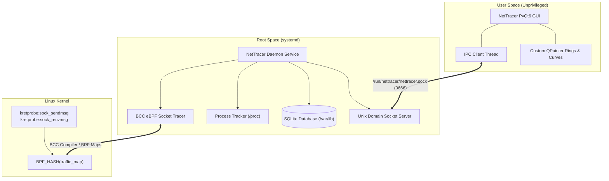

# NetTracer

[](LICENSE)
[](#)
[](#)
[](https://www.python.org/)
[](https://riverbankcomputing.com/software/pyqt/)
[](#)

English | [فارسی](README_FA.md)

A native, high-performance per-process network bandwidth monitoring application for **Arch Linux**. Engineered with kernel-level **eBPF (BCC)** probes, non-blocking **Unix Domain Sockets**, **SQLite** historical persistence, and a native **PyQt6** desktop interface styled after modern dark-mode glassmorphic aesthetics.

---

## Overview

NetTracer provides transparent, real-time insight into network bandwidth consumption on Linux systems without impacting socket performance. Built with strict **Privilege Separation**, it isolates root kernel tracing from unprivileged user-space UI rendering.

Key Highlights:
- **Zero Overhead Kernel Tracing**: Hooks directly into kernel socket primitives (`sock_sendmsg` and `sock_recvmsg`) via eBPF kretprobes to measure accurate per-PID byte transfers.
- **Strict Privilege Separation**: Root monitoring daemon runs as an isolated systemd service; user interface runs completely unprivileged in user space.
- **High-Throughput IPC**: Streamlined JSON telemetry over local Unix Domain Sockets (`/run/nettracer/nettracer.sock`).
- **Native Qt Desktop Experience**: 100% native PyQt6 widgets and custom QSS (no WebEngine overhead) featuring animated toggle switches, custom QPainter circular progress rings, and real-time bandwidth curves.
- **1-Minute SQLite Aggregations**: Automatic periodic rolling bucket persistence with configurable data retention policies.

---

## Features

- **Real-Time Bandwidth Gauges**: Live download and upload speed indicators with sub-second responsiveness.
- **Per-Process Traffic Inspection**: Scrollable cards displaying PID, application name, icon, received (RX), and transmitted (TX) totals.
- **Top Bandwidth Consumers**: Custom vector circular progress rings indicating usage percentages of active top consumers.
- **Traffic Analytics & Curves**: Live dynamic bandwidth visualization rendered with antialiased Qt vector paths.
- **Historical Usage Logs**: Searchable, timestamped SQLite audit logs with a one-click history purge option.
- **Network Quota & Rules**: User-configurable daily bandwidth quota limit (`GB/day`) with editable input spinner and warning triggers.
- **Customizable Preferences**: Toggle launch on boot, strict eBPF packet filtering, and data retention windows (7 days, 30 days, or forever).
- **Graceful Fallback Mode**: Automatically falls back to simulated telemetry when developing or running without root privileges.

---

## Architecture



---

## Getting Started

### Prerequisites

NetTracer is designed for Arch Linux and its derivatives (EndeavourOS, Manjaro, Parch Linux).

Install the core system packages via `pacman`:

```bash
sudo pacman -S --needed \
    linux-headers \
    bcc \
    python-bcc \
    python-pyqt6 \
    python-psutil \
    sqlite
```

> **Note**: Ensure `linux-headers` matches your active running kernel (`uname -r`). If using `linux-zen` or `linux-lts`, install `linux-zen-headers` or `linux-lts-headers` instead.

---

### Installation

#### 1. Clone the Repository
```bash
git clone https://github.com/soheilabbasnia/net-tracer.git
cd net-tracer
```

#### 2. Install Desktop Launcher & User Symlinks
Install NetTracer to your local user directory:
```bash
# Create local bin and application entry
mkdir -p ~/.local/bin ~/.local/share/applications

# Create launcher symlinks
ln -sf $(pwd)/bin/nettracer-gui ~/.local/bin/nettracer
ln -sf $(pwd)/bin/nettracer-daemon ~/.local/bin/nettracer-daemon

# Install desktop shortcut
cp resources/nettracer.desktop ~/.local/share/applications/
update-desktop-database ~/.local/share/applications/
```

#### 3. Enable Systemd Daemon (Root Monitoring Service)
Deploy and start the background monitoring service:
```bash
# Copy systemd unit file
sudo cp systemd/nettracer.service /etc/systemd/system/

# Install daemon files to /opt/nettracer
sudo mkdir -p /opt/nettracer
sudo cp -r daemon bin requirements.txt /opt/nettracer/

# Reload systemd and start service
sudo systemctl daemon-reload
sudo systemctl enable --now nettracer.service
```

Verify service status:
```bash
sudo systemctl status nettracer.service
```

---

## Usage

### Launching the Desktop Application

You can launch NetTracer directly from your application launcher (KDE, GNOME, Rofi, dmenu) or via command line:

```bash
nettracer
```

If the root daemon is active, NetTracer connects to `/run/nettracer/nettracer.sock` and begins streaming live network metrics. If the daemon is not running yet, NetTracer automatically activates an interactive simulation mode so the interface remains fully operational for inspection.

---

## Project Structure

```text
net-tracer/
├── bin/
│   ├── nettracer-daemon         # Executable entrypoint for monitoring daemon
│   └── nettracer-gui            # Executable entrypoint for desktop GUI
├── daemon/
│   ├── __init__.py
│   ├── bpf_tracer.py            # BCC eBPF kretprobes on socket I/O
│   ├── db.py                    # SQLite database persistence & history query
│   ├── ipc_server.py            # Unix domain socket broadcast server
│   ├── process_tracker.py       # PID-to-process resolver via /proc
│   └── service.py               # Main monitoring daemon coordinator
├── gui/
│   ├── __init__.py
│   ├── app.py                   # PyQt6 MainWindow & controller
│   ├── ipc_client.py            # Threaded IPC client with fallback simulation
│   ├── styles.py                # Design system & QSS stylesheets
│   └── widgets/
│       ├── __init__.py
│       ├── circular_progress.py # Custom QPainter circular progress rings
│       ├── dock.py              # Floating right navigation pill dock
│       ├── sidebar.py           # Left profile and metrics panel
│       ├── toggle_switch.py     # Custom animated iOS/Tailwind toggle switches
│       ├── views_charts.py      # Charts / Traffic Analytics view
│       ├── views_dashboard.py   # Dashboard view with speed box & process cards
│       ├── views_history.py     # History log view with SQLite records
│       ├── views_security.py    # Network Rules & editable Daily Quota (QSpinBox)
│       └── views_settings.py    # Preferences view (Startup, Mode, Retention)
├── resources/
│   └── nettracer.desktop        # Linux desktop launcher entry
├── systemd/
│   └── nettracer.service        # Systemd unit file for root daemon
├── nettracer_ui.html            # Original HTML/Tailwind design reference
├── requirements.txt             # Python dependencies
├── LICENSE                      # MIT License
├── README.md                    # English Documentation
└── README_FA.md                 # Persian Documentation
```

---

## Security & Privilege Separation

- **Unprivileged Desktop Application**: The GUI runs under your standard desktop user account without elevated permissions, protecting your graphical environment.
- **Hardened Systemd Service**: The daemon runs with minimal kernel capabilities:
  `CAP_BPF`, `CAP_NET_ADMIN`, `CAP_PERFMON`, `CAP_SYS_RESOURCE`, `CAP_SYS_ADMIN`
- **Filesystem Isolation**: The daemon enforces `ProtectSystem=full`, `ProtectHome=true`, and private runtime directories (`RuntimeDirectory=nettracer`).

---

## License

This project is licensed under the terms of the [MIT License](LICENSE).  
Copyright (c) 2026 Soheil Abbasnia.
