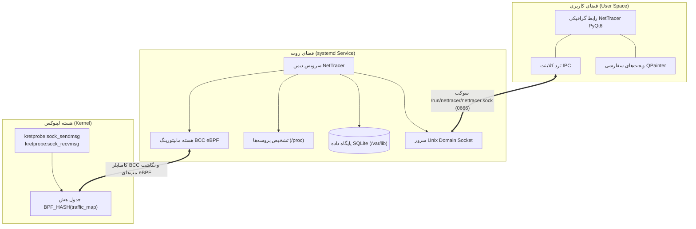

<div dir="rtl">

# سامانه پایش پهنای باند نت‌تریسر (NetTracer)

[](LICENSE)
[](#)
[](#)
[](https://www.python.org/)
[](https://riverbankcomputing.com/software/pyqt/)
[](#)

[English](README.md) | فارسی

یک اپلیکیشن دسکتاپ نیتیو و فوق‌سریع برای پایش ترافیک مصرفی اینترنت به ازای هر پروسه (Per-App Bandwidth) ویژه **آرچ لینوکس (Arch Linux)**. پیاده‌سازی شده با پروب‌های هسته لینوکس بر بستر **eBPF (BCC)**، کانال ارتباطی غیرمسدودکننده **Unix Domain Sockets**، پایگاه داده سبک **SQLite** و رابط کاربری نیتیو **PyQt6** با طراحی مدرن Dark Glassmorphism.

---

## نمای کلی پروژه

نت‌تریسر بدون تحمیل کوچک‌ترین افت کارایی یا سربار روی سوکت‌های شبکه، ترافیک ارسالی (TX) و دریافتی (RX) را در سطح پروسه‌های سیستم ردیابی می‌کند. این سیستم با رعایت دقیق اصل **تفکیک سطوح دسترسی (Privilege Separation)** طراحی شده است تا بخش مانیتورینگ سطح روت از رابط گرافیکی فضای کاربر کاملاً مجزا باشد.

نکات برجسته:
- **پایش در سطح هسته لینوکس با eBPF:** هوک مستقیم به توابع هسته (`sock_sendmsg` و `sock_recvmsg`) از طریق BCC kretprobes بدون افت سرعت شبکه.
- **تفکیک کامل دسترسی‌ها (Privilege Separation):** هسته مانیتورینگ (Daemon) در قالب سرویس systemd تحت دسترسی Root اجرا می‌شود و رابط کاربری (GUI) در فضای کاربری معمولی و بدون نیاز به دسترسی ادمین فعال می‌گردد.
- **ارتباطات فوق سریع IPC:** ارسال بلادرنگ استریم تلمتری JSON از طریق سوکت‌های استاندارد یونیکس (`/run/nettracer/nettracer.sock`).
- **رابط کاربری نیتیو PyQt6 (بدون WebEngine):** استفاده ۱۰۰٪ از ویجت‌های نیتیو و استایل‌های سفارشی QSS، به همراه سوئیچ‌های تاگل انیمیشنی، حلقه‌های درصد مصرف برداری (QPainter) و رسم زنده نمودار مصرف.
- **ذخیره‌سازی تجمیعی ۱ دقیقه‌ای در SQLite:** ثبت خودکار آمار دوره‌ای به تفکیک نام برنامه به همراه مدیریت چرخه نگهداری داده‌ها (Retention).

---

## ویژگی‌های کلیدی

- **نمایشگر لحظه‌ای سرعت اینترنت:** سرعت دانلود و آپلود سیستم به صورت ثانیه‌ای با دقت بالا.
- **فهرست تفکیکی پروسه‌ها:** کارت‌های روان شامل نام برنامه، شناسه PID، آیکون اختصاصی و میزان کل دریافت (RX) و ارسال (TX).
- **مصرف‌کنندگان برتر (Top Consumers):** حلقه‌های پیشرفت دایره‌ای با رندر برداری `QPainter` جهت نمایش سهم مصرف برنامه‌های فعال (کروم، تلگرام، اسپاتیفای و...).
- **نمودار و آنالیز ترافیک:** رسم پویای خطوط ترافیک شبکه با استفاده از مسیرهای برداری آنتی‌الیاس Qt.
- **تاریخچه و لاگ مصرف:** لاگ تایم‌استمپ‌دار دیتابیس SQLite با قابلیت پاکسازی تاریخچه با یک کلیک.
- **قوانین و سقف مصرف روزانه (Quota):** تنظیم سقف حجم روزانه (`GB/day`) با کنترلر عددی تعاملی و فعال‌سازی هشدار عبور از سقف.
- **شخصی‌سازی تنظیمات:** امکان تنظیم اجرای خودکار با بوت سیستم، حالت سخت‌گیرانه eBPF Strict Mode و چرخه نگهداری تاریخچه (۷ روز، ۳۰ روز یا نامحدود).
- **حالت شبیه‌ساز هوشمند (Simulation Fallback):** قابلیت اجرای تستی رابط کاربری حتی در صورت متوقف بودن دیمن مانیتورینگ هسته.

---

## معماری سیستم



---

## پیش‌نیازها و نصب

### پیش‌نیازها

نت‌تریسر برای آرچ لینوکس و توزیع‌های مبتنی بر آن (مانند EndeavourOS, Manjaro, Parch Linux) بهینه‌سازی شده است.

بسته‌های سیستمی و کتابخانه‌های مورد نیاز را با `pacman` نصب کنید:

```bash
sudo pacman -S --needed \
    linux-headers \
    bcc \
    python-bcc \
    python-pyqt6 \
    python-psutil \
    sqlite
```

> **نکته:** بسته `linux-headers` باید با نسخه کرنل فعال شما (`uname -r`) مطابقت داشته باشد. اگر از کرنل‌های `linux-zen` یا `linux-lts` استفاده می‌کنید، به ترتیب پکیج‌های `linux-zen-headers` یا `linux-lts-headers` را نصب فرمایید.

---

### مراحل نصب

#### ۱. دریافت مخزن پروژه
```bash
git clone https://github.com/soheilabbasnia/net-tracer.git
cd net-tracer
```

#### ۲. نصب شورت‌کات دسکتاپ و لینک‌های اجرایی
برای ایجاد دسترسی آسان و افزودن برنامه به منوی برنامه‌های لینوکس:
```bash
# ایجاد پوشه‌های استاندارد محلی کاربر
mkdir -p ~/.local/bin ~/.local/share/applications

# ایجاد لینک‌های اجرایی
ln -sf $(pwd)/bin/nettracer-gui ~/.local/bin/nettracer
ln -sf $(pwd)/bin/nettracer-daemon ~/.local/bin/nettracer-daemon

# نصب لانچر منوی دسکتاپ
cp resources/nettracer.desktop ~/.local/share/applications/
update-desktop-database ~/.local/share/applications/
```

#### ۳. راه‌اندازی سرویس مانیتورینگ systemd
سرویس پس‌زمینه روت را مستقر و فعال نمایید:
```bash
# کپی فایل سرویس
sudo cp systemd/nettracer.service /etc/systemd/system/

# انتقال فایل‌های اجرایی دیمن به مسیر استاندارد /opt
sudo mkdir -p /opt/nettracer
sudo cp -r daemon bin requirements.txt /opt/nettracer/

# بارگذاری مجدد و استارت خودکار سرویس
sudo systemctl daemon-reload
sudo systemctl enable --now nettracer.service
```

بررسی وضعیت فعال بودن سرویس:
```bash
sudo systemctl status nettracer.service
```

---

## نحوه اجرا

### اجرای رابط گرافیکی

برنامه را می‌توانید به طور مستقیم از منوی دسکتاپ (KDE, GNOME, Rofi, dmenu) یا از طریق ترمینال اجرا کنید:

```bash
nettracer
```

در صورت فعال بودن سرویس روت، رابط کاربری به سوکت `/run/nettracer/nettracer.sock` متصل شده و ترافیک واقعی را به نمایش می‌گذارد. در صورت فعال نبودن سرویس، کلاینت به شکل خودکار روی حالت نمایشی زنده (Simulation) سوئیچ می‌کند تا امکان بررسی و آزمایش رابط کاربری بدون روت نیز فراهم باشد.

---

## ساختار پروژه

```text
net-tracer/
├── bin/
│   ├── nettracer-daemon         # فایل اجرایی دیمن مانیتورینگ هسته
│   └── nettracer-gui            # فایل اجرایی کلاینت دسکتاپ PyQt6
├── daemon/
│   ├── __init__.py
│   ├── bpf_tracer.py            # پروب‌های eBPF هسته به کمک BCC
│   ├── db.py                    # دیتابیس SQLite و لاگ‌های دوره‌ای
│   ├── ipc_server.py            # سرور برودکست Unix Domain Socket
│   ├── process_tracker.py       # مپینگ نام پروسه‌ها از مسیر /proc
│   └── service.py               # سرویس هماهنگ‌کننده مرکزی مانیتورینگ
├── gui/
│   ├── __init__.py
│   ├── app.py                   # کنترلر و پنجره اصلی PyQt6
│   ├── ipc_client.py            # کلاینت IPC با پشتیبانی از حالت شبیه‌ساز
│   ├── styles.py                # سیستم دیزاین و استایل‌شیت‌های سفارشی QSS
│   └── widgets/
│       ├── __init__.py
│       ├── circular_progress.py # ویجت حلقه‌های درصد مصرف (QPainter)
│       ├── dock.py              # داک شناور بیضی برای تغییر صفحات
│       ├── sidebar.py           # کارت خلاصه وضعیت سمت چپ
│       ├── toggle_switch.py     # سوئیچ‌های تاگل انیمیشنی مدرن
│       ├── views_charts.py      # تب تحلیل ترافیک و نمودار زنده
│       ├── views_dashboard.py   # تب اصلی داشبورد و کارت‌های پروسه
│       ├── views_history.py     # تب لاگ تاریخچه با دیتای SQLite
│       ├── views_security.py    # تب امنیت و فیلد عددی سقف حجم روزانه
│       └── views_settings.py    # تب تنظیمات (Startup, Mode, Retention)
├── resources/
│   └── nettracer.desktop        # فایل استاندارد لانچر دسکتاپ لینوکس
├── systemd/
│   └── nettracer.service        # فایل سرویس systemd برای دیمن روت
├── nettracer_ui.html            # پروتوتایپ مرجع ارسالی
├── requirements.txt             # نیازمندی‌های پایتون
├── LICENSE                      # مجوز MIT
├── README.md                    # مستندات انگلیسی
└── README_FA.md                 # مستندات فارسی
```

---

## امنیت و تفکیک دسترسی‌ها

- **رابط کاربری غیر روت:** برنامه دسکتاپ در نشست کاربری استاندارد اجرا شده و هیچ نیازی به دسترسی سطح بالا یا کلیدهای امنیتی ندارد.
- **سرویس سخت‌سازی شده systemd:** دیمن هسته تنها با دسترسی‌های حداقلی لینوکس اجرا می‌گردد:  
  `CAP_BPF`، `CAP_NET_ADMIN`، `CAP_PERFMON`، `CAP_SYS_RESOURCE`، `CAP_SYS_ADMIN`
- **ایزوله‌سازی فایل‌سیستم:** تنظیمات `ProtectSystem=full` و `ProtectHome=true` دیمن را در برابر تغییرات ناخواسته بر روی فایل‌های حیاتی سیستم ایمن می‌سازد.

---

## مجوز (License)

این پروژه تحت مجوز [MIT](LICENSE) منتشر شده است.  
Copyright (c) 2026 Soheil Abbasnia.

</div>
